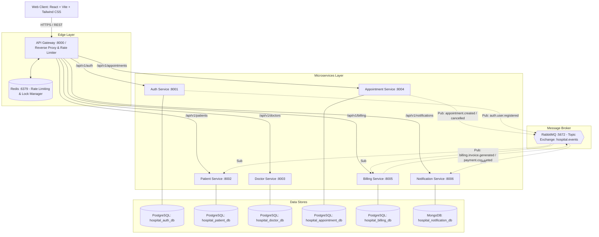

# Smart Hospital Management & Appointment Platform

An enterprise-grade, distributed healthcare microservices platform built with TypeScript, Node.js, Express, React, PostgreSQL, MongoDB, Redis, and RabbitMQ.

---

## 1. High-Level Architecture

The platform follows Domain-Driven Design (DDD) with strict database-per-service isolation and asynchronous event-driven communication via RabbitMQ.



---

## 2. Microservice Boundaries & Responsibilities

| Service | Port | Database | Responsibilities |
| :--- | :---: | :---: | :--- |
| **API Gateway** | `8000` | Redis / Memory | Reverse proxy, rate limiting, Bearer JWT validation, header enrichment (`X-User-Id`, `X-User-Role`, `X-Correlation-Id`), centralized error handling. |
| **Auth Service** | `8001` | PostgreSQL | Identity registration, login, bcrypt password hashing, rotating refresh tokens, RBAC permissions, profile verification. |
| **Patient Service** | `8002` | PostgreSQL | Patient demographics, contact info, emergency contacts, medical history & clinical records, patient directory filters. |
| **Doctor Service** | `8003` | PostgreSQL | Medical departments, doctor profiles, consultation fees, weekly availability rosters, dynamic 30-min slot calculation. |
| **Appointment Service**| `8004`| PostgreSQL | Concurrency-safe booking, distributed lock protection, unique slot constraints, appointment rescheduling and status lifecycle. |
| **Billing Service** | `8005` | PostgreSQL | Automatic invoice creation upon booking events, mock payment gateway processing, refund simulations, financial analytics. |
| **Notification Service**| `8006`| MongoDB | Async RabbitMQ event consumer (DLQ enabled), email and in-app notifications, delivery audit logs. |
| **AI Copilot (Ollama)** | `11434`| Ollama (`alpine/ollama:latest`)| Clinical diagnostic copilot, patient symptom triage, differential diagnosis assistance. |

---

## 3. Concurrency Control: Double-Booking Prevention

To eliminate race conditions when multiple patients race for the exact same slot:
1. **Application Distributed Lock**: Mutex lock check on `lock:slot:{doctorId}:{date}:{slotTime}`.
2. **Transactional Concurrency**: `SELECT ... FOR UPDATE` on appointments within transactional boundaries.
3. **Database Unique Constraint**: Partial unique index on `appointments(doctor_id, appointment_date, start_time)` where `status != 'CANCELLED'`.
4. **Slot Release**: Cancelled appointments immediately release the slot for new bookings.

---

## 4. AI Clinical Engine (`alpine/ollama:latest`)

The platform integrates local Large Language Model (LLM) inference running on **Ollama** (`alpine/ollama:latest`, container user: `ai`):
- **Patient Symptom Triage**: `POST /api/v1/ai/triage` analyzes free-text symptoms, assigns clinical urgency (`ROUTINE`, `URGENT`, `EMERGENCY`), and guides patients to the appropriate department.
- **Doctor Diagnostic Copilot**: `POST /api/v1/ai/copilot` analyzes the patient's medical history, age, and symptoms to suggest differential diagnoses, recommended diagnostic workups, and prescription guidelines during consultations.
- **Resilient Fallback**: Operates seamlessly with deterministic rule-based clinical evaluation when the Ollama container is starting or offline.

---

## 5. Role-Based Access Control (RBAC) & Default Credentials

Pre-seeded accounts are provided for instant evaluation:

| Role | Email | Password | Permissions & Dashboard Scope |
| :--- | :--- | :--- | :--- |
| **Super Admin** | `superadmin@hospital.com` | `Admin@12345` | Global bypass, all services, analytics, staff. |
| **Hospital Admin** | `admin@hospital.com` | `Admin@12345` | Department creation, doctor registration, analytics. |
| **Doctor** | `doctor@hospital.com` | `Doctor@12345` | Today's schedule, start visit, complete & prescribe. |
| **Receptionist** | `receptionist@hospital.com` | `Staff@12345` | Walk-in patient registration, arrival check-in. |
| **Patient** | `patient@hospital.com` | `Patient@12345` | Doctor search, book slot, pay invoice, cancel. |
| **Accountant** | `accountant@hospital.com` | `Account@12345` | Invoices ledger, payment records, refund simulation. |

---

## 5. Quick Start & Local Setup

### Prerequisites
- Node.js >= 18
- Docker & Docker Compose (for infrastructure containers)

### 1. Boot Infrastructure (PostgreSQL, MongoDB, Redis, RabbitMQ)
```bash
docker compose up -d
```
*Note: `./docker/postgres/init-databases.sh` automatically initializes the 5 independent PostgreSQL databases.*

### 2. Install Dependencies & Build Packages
```bash
npm install
npm run build
```

### 3. Run Automated Tests
```bash
# Run all unit, integration, concurrency, and API tests
npm test

# Run End-to-End clinical lifecycle test
npx jest --config tests/e2e/jest.config.js --no-watchman --runInBand
```

### 4. Start Microservices Locally
In separate terminals or using your process manager:
```bash
# Edge & Core Services
npm run dev:gateway      # Port 8000
npm run dev:auth         # Port 8001
npm run dev:patient      # Port 8002
npm run dev:doctor       # Port 8003
npm run dev:appointment  # Port 8004
npm run dev:billing      # Port 8005
npm run dev:notification # Port 8006

# Frontend React Client
npm run dev:client       # Port 3000 (Vite)
```

Open `http://localhost:3000` in your browser. Use the **1-Click Instant Demo Login** buttons to experience any role's clinical dashboard!

---

## 6. Monorepo Structure

```text
smart-hospital-platform/
├── packages/
│   └── common/                         # @hospital/common (Shared types, errors, event bus, middlewares)
├── services/
│   ├── api-gateway/                    # Port 8000 (Reverse proxy, rate limiting, auth guard)
│   ├── auth-service/                   # Port 8001 (PostgreSQL: hospital_auth_db)
│   ├── patient-service/                # Port 8002 (PostgreSQL: hospital_patient_db)
│   ├── doctor-service/                 # Port 8003 (PostgreSQL: hospital_doctor_db)
│   ├── appointment-service/            # Port 8004 (PostgreSQL: hospital_appointment_db)
│   ├── billing-service/                # Port 8005 (PostgreSQL: hospital_billing_db)
│   └── notification-service/           # Port 8006 (MongoDB: hospital_notification_db)
├── client/                             # React + Vite + Tailwind CSS + TanStack Query + Recharts
├── tests/
│   └── e2e/                            # Full clinical lifecycle workflow tests
├── docker/
│   └── postgres/                       # DDL database initialization scripts
├── docker-compose.yml                  # Infrastructure container definitions
└── package.json                        # Monorepo workspaces configuration
```
